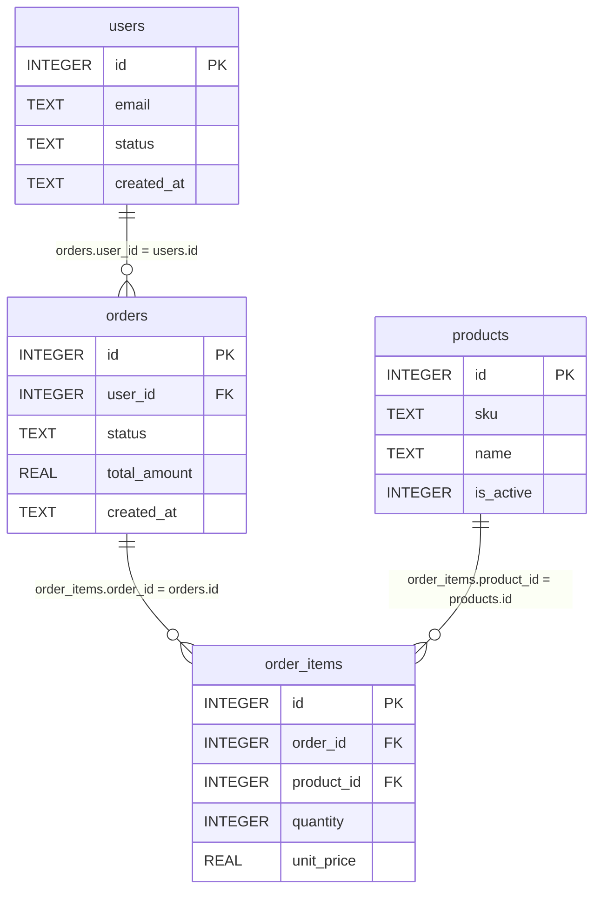

# Schéma SQL (jeu d’entraînement)

Requêtes de contrôle : `exercice.sql`

```bash
sqlite3 ../entrainement_sql_python/data/qa_training.db < exercice.sql
```

Une commande appartient à un user. Une ligne panier appartient à une commande et à un produit.



Lecture : `users ||--o{ orders` = un user a 0, 1 ou N commandes ; une commande a un seul `user_id`.

`is_active` : 1 = en vente, 0 = retiré.

## users

| id | email | status | created_at |
|----|-------|--------|------------|
| 1 | alice@example.com | active | 2024-01-10 |
| 2 | bob@example.com | active | 2024-02-01 |
| 3 | alice@example.com | active | 2024-03-15 |
| 4 | invalid-email | active | 2024-04-01 |
| 5 | inactive@example.com | inactive | 2024-05-01 |
| 6 | NULL | active | 2024-06-01 |

## products

| id | sku | name | is_active |
|----|-----|------|-----------|
| 1 | SKU-001 | Clavier | 1 |
| 2 | SKU-002 | Souris | 1 |
| 3 | SKU-OLD | Produit retiré | 0 |

## orders

| id | user_id | status | total_amount | created_at |
|----|---------|--------|--------------|------------|
| 101 | 1 | paid | 120.0 | 2024-06-01 |
| 102 | 1 | paid | 50.0 | 2024-06-02 |
| 103 | 999 | paid | 30.0 | 2024-06-03 |
| 104 | 2 | cancelled | 0.0 | 2024-06-04 |
| 105 | 2 | paid | -10.0 | 2024-06-05 |
| 106 | 5 | pending | 80.0 | 2024-06-06 |

## order_items

| id | order_id | product_id | quantity | unit_price |
|----|----------|------------|----------|------------|
| 1 | 101 | 1 | 1 | 100.0 |
| 2 | 101 | 2 | 1 | 20.0 |
| 3 | 102 | 2 | 2 | 25.0 |
| 4 | 105 | 1 | 1 | 5.0 |
| 5 | 106 | 3 | 1 | 80.0 |
| 6 | 999 | 1 | 1 | 10.0 |
